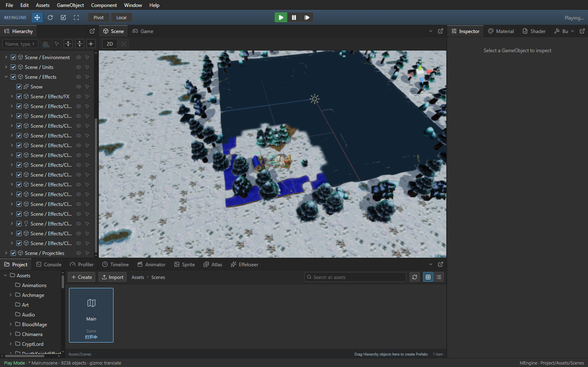

# 地形块参数与网格绑定复用

Author: MiYu

客户端按当前 36 个地表值检查已有的地形块参数，仅在变化时重新打包。64 个地图块各自缓存固定采样索引，边界沿用原有夹取规则；地图外和小数坐标继续使用原始公式。chunk() 仍返回独立的 9 x 4 数组。地表值仍每次计算，迷雾、腐地和地表编辑会立即更新。地表类型单独检查；地形、河床、水面最多复用 192 个网格绑定，只有 mesh、material、bed 全部相同时跳过 MeshRenderer 序列化。水面时间和颜色参数仍每次更新。缓存不持有地图或运行状态。

## Release 对照

同一 EXE、同一隔离工程，按旧版、新版、新版重复、旧版重复执行；采样期间不运行构建或 CPU 测试。Game 每次采样 12 秒，只交换生成 Main.js；结束后恢复原始脚本并核对 SHA-256。

| 指标 | 第一组旧版 | 第一组新版 | 第二组旧版 | 第二组新版 |
| --- | ---: | ---: | ---: | ---: |
| 模拟推进（次/秒） | 38.82 | 40.13 | 39.33 | 40.49 |
| 不同世界版本绘制（次/秒） | 38.06 | 38.85 | 38.51 | 39.49 |
| 不同状态绘制间隔 P95（ms） | 45.30 | 44.00 | 46.40 | 44.30 |
| 编辑态 Scene 空画面 | 0.00 | 0.00 | 0.00 | 0.00 |
| 运行态 Scene 空画面 | 0 | 0 | 0 | 0 |
| 移动时完成的原生帧 | 119 | 120 | 119 | 120 |

第 1 组模拟推进 +3.4%，不同世界版本绘制 +2.1%；第 2 组模拟推进 +3.0%，不同世界版本绘制 +2.6%。数据是本机模拟推进和不同世界版本的实际画布绘制，不能当作物理显示器 FPS。稳定 60 FPS 和其他机器上的流畅性仍需继续验证。

## Scene 移动连续显示

每次在编辑态及运行态各连续右键移动 Scene 视角 12 秒。运行态先确认激活的原始 Warcraft 树木、城镇大厅和农民模型具有实际动画 mesh 引用，摄像机对准玩家基地；移动中保留截图，记录主画布绘制、完全空画面和完成的不同原生帧。模拟须在移动期间持续推进；空画面须为 0。四次均满足这些条件。另一次运行态复验确认右键旋转的 yaw/pitch 和中键平移的 pivot 确实变化，两种操作的空画面均为 0。当前运行态 Scene 新原生帧约 10 张/秒，持续可见已验收，流畅度仍需继续优化。实际 WebView GPU 像素、模型选择、层级展开滚动、暂停时钟、精确单步及停止重启检查通过；无控制台 error，QA 进程均退出。

Scene 显示使用最近完成且尺寸、显隐设置兼容的原生帧，直到新相机帧完成；图像、相机、命中区域共用同一帧数据。请求持续追赶最新视角，避免拖动期间清除整个模型画面。该通用引擎和编辑器实现已同步到 master，本次源代码优化位于游戏脚本。

## 验证

- 生成 Main.js 地形节点对照 18 组；64 个地图块、越界和小数坐标的独立打包公式对照 69 组。重复帧打包及 MeshRenderer setter 调用均为 0。
- 与 7a7a7ee 完整世界对照 90 组，9,019 个实体；覆盖三类地图、四种视口、地形/水面/地表/物件编辑、动画时钟、迷雾和菜单/编辑/游戏切换。
- ground-display、terrain、ground-detail、tilesets、minimap-client、ground-cache 六组回归通过；独立只读审核无阻断。
- 使用 MENGINE_FROST_BUILD_OUTPUT 和 node scripts/build-frostbound.mjs 生成隔离 Main.js，核对精确字节。

测试入口：`node scripts/test-frost-ground-bindings.mjs` 和 `node scripts/test-frost-ground-display.mjs 7a7a7ee`。EXE、脚本哈希、运行态模型和四次原始报告路径见 [验收记录](ground-binding-performance.json)。
