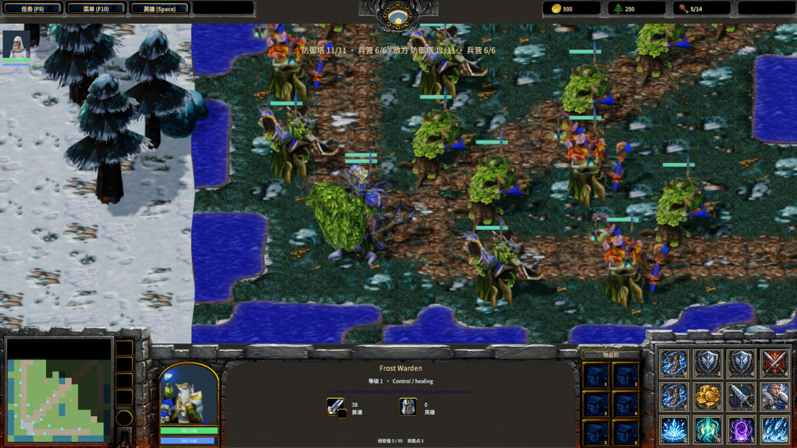
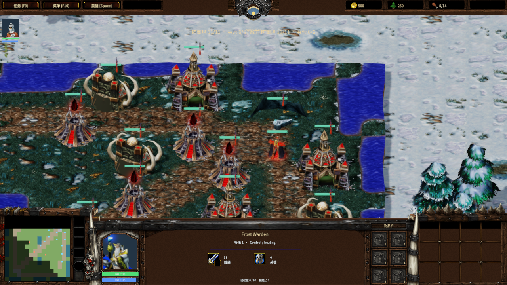
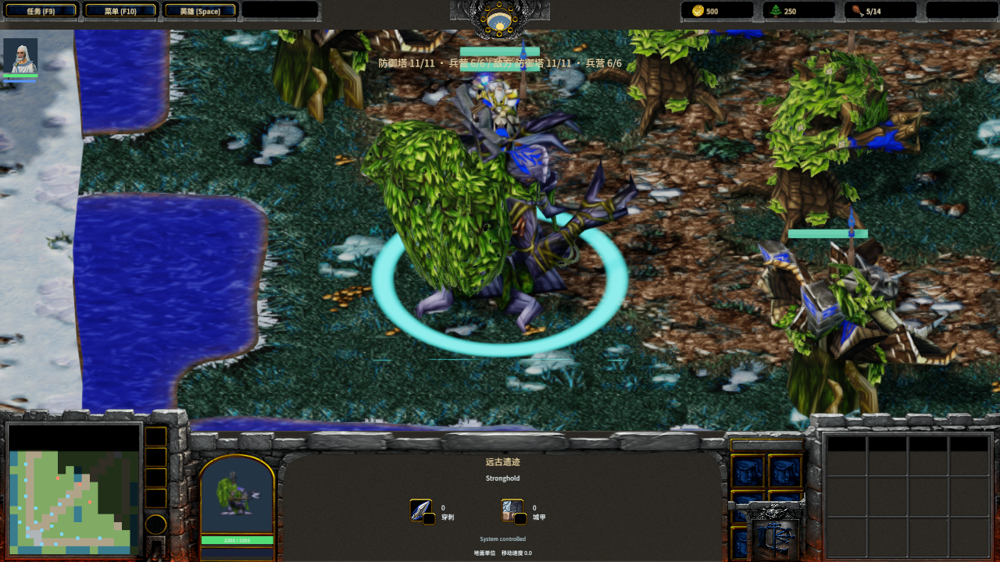
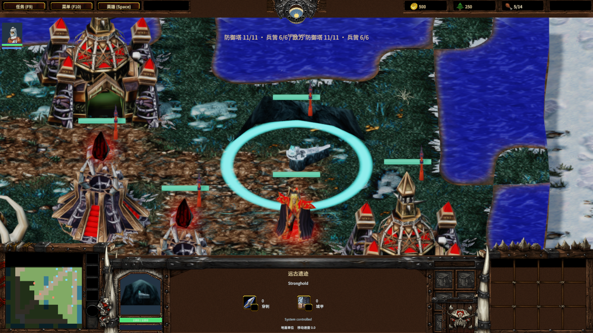

# MOBA 基地模型与双端验收

Author: MiYu

天灾远古遗迹使用原版 FrozenThrone 模型；近卫远程兵营使用原版 Ancient of Lore。导入保留五个冰封王座部件的源动画、材质和节点 billboard。冰封王座采用地图配置比例 0.07 × 世界比例 2，模型范围约 6.56 × 3.70 × 6.56；该比例为本地图配置，并非已核实的某个 DotA 版本物件数据。其他建筑继续使用各自目录中的比例。

来源位于 `asset-library/warcraft-iii/remaining-ready`，原始 MDX、转换许可证和来源签名收录在 `SourceAssets/Moba`、`SourceAssets/WarcraftIII` 及 `moba-model-sources.json`。56 个签名输出覆盖模型、纹理、材质、配套元数据及来源文件。导入在提交任何输出前检查已有文件，拒绝覆盖用户修改；模型、贴图和材质缺少 `.meta` 时停止。Warcraft III 资产归 Blizzard 所有，不属于 CC0 或引擎 MIT 许可。

## 验证

- 导入逐字节复现、56 个输出签名、全部模型／贴图／材质元数据和修改文件保护通过。
- 生成的 `Main.js` 和 `Main.mscene` 逐字节复现：4,259 个实体、431 个模型条目。
- MOBA 规则及生成客户端测试通过，覆盖 36 个目标、保护条件、拆塔／兵营／远古遗迹推进、强化兵线、保存恢复及选择界面。
- Release 原生 Editor 检查两边共 8 个远古遗迹／远程兵营的模型、比例和 Stand 动画，材质拒绝与控制台错误为 0。截图等待原生 `worldRevision` 等于已完成单步的帧号；每边保存基地全景和选中远古遗迹近景。报告：`native-moba-art-validation.json`。
- 两个独立 V8 Player 连接真实 TCP 权威服务器：56 份客户端快照与对应服务端快照一致，同帧比较 18 个双方可见单位；两个客户端独立模拟次数均为 0。拆塔、两个近战兵营摧毁、强化兵线、暂停快照发送、断线恢复及指令序号重置通过，两个 Player 正常退出。报告：`native-moba-objectives-validation.json`。

联机验收使用加速战斗夹具：建筑 50 HP，英雄 10,000 HP／1,000 伤害／12 移速。双端先记录完整基地，再把英雄移至对方路线；首波在此后 180 帧出现。停发测试等待已发送的在途快照被消费；末尾检查两端均进入服务器决定的胜负界面，并按完整内容签名核对结束后仍在变化的尸体表现快照。该验收证明记录帧的一致性，不等于完整对局平衡或跨机器 LAN 验收。

原生验收后的导入复查只补齐了纹理元数据和签名清单；模型、贴图、材质以及已验收的客户端／场景字节不变。

## 画面与后续






基地建筑已重新分布，自动装饰树按建筑投影避让；地图编辑器支持配置两边的塔和兵营位置，详见 `moba-base-layout.md`。当前地图仍为缩尺三路 MOBA；完整经典 DotA 地图、英雄／物品和完整 Warcraft III 游戏复刻尚未完成。

## 复验入口

```text
python scripts/test-frost-moba-art.py --pose-probe <gltf_bounds.exe> --metadata-reader <NodeMetadata.dll>
node scripts/test-frost-moba-objectives.mjs
node scripts/test-frost-moba-objectives-client.mjs
node scripts/qa-frost-moba-art.mjs
node scripts/qa-frost-native-authority.mjs --moba-objectives
```

原生脚本使用 `MENGINE_QA_ROOT`、`MENGINE_QA_PROJECT_ROOT`、`MENGINE_EDITOR_EXECUTABLE` 或 `MENGINE_RUNTIME_EXECUTABLE` 指定临时目录、完整资产工程及 Release 二进制。精简检出需先补齐相关源资产及 Agent Bridge 文件；不要将缺失依赖误判为游戏运行失败。
