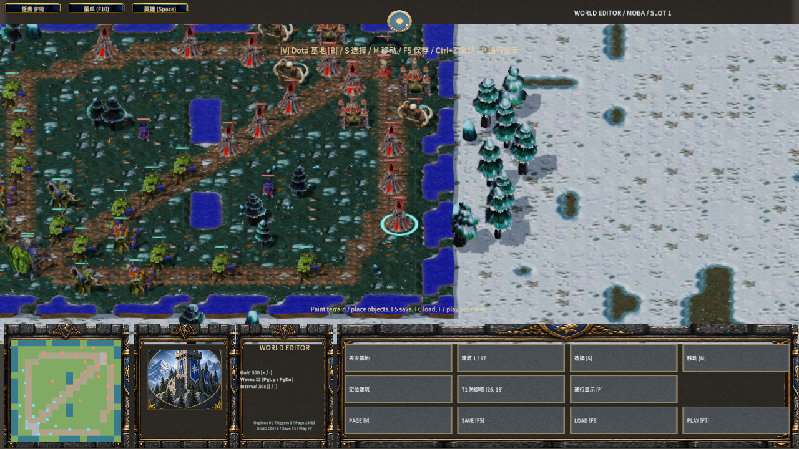

# Dota 基地布局与地图编辑

Author: MiYu

内置三路 MOBA 地图由 `Assets/Maps/moba.json` 配置两边防御塔和兵营位置。建筑按源模型比例显示，基地为主建筑和三条路线保留间距；自动装饰树按相机投影避让可见的基地建筑，包括边界树。可交互的资源树保持模型与碰撞一致。

## 地图与兼容

`mobaLayout` 为两组各 17 个 `[x,z]` 坐标。每组三条路线依次记录 T1、T2、T3、近战兵营、远程兵营，最后记录两座 T4；远古遗迹位置仍取 `spawns`。坐标限制在 ±27，加载时检查有限数值、建筑间距、平地、水面、资源树和阻挡物。无此字段的旧地图保留原布局；切换为其他地图模式时保留配置，切回 MOBA 时重新校验。

客户端和权威服务器共用布局规则。协议版本为 95，保存、恢复、建房和公开状态快照均保留布局；版本不匹配的客户端不能加入。

## 操作

地图编辑器中按 B 打开基地页，面板切换近卫／天灾和目标建筑。S 选择，M 后点击地面按 0.5 单位移动；定位建筑按钮移动相机。无效位置回滚。Ctrl+Z 撤销、F5 保存、F6 加载、F7 试玩；试玩菜单退出返回编辑器。V 循环所有编辑页，P 显示通行区域。

## 验证

- 布局测试覆盖 34 个目标位置、实际朝向的源模型占地、兵营与 T3 的顺序、两边共六个英雄出基地通路、保存恢复、非法位置和旧地图兼容。
- 生成客户端输入测试覆盖双阵营移动、重叠回滚、撤销、保存加载、试玩返回及使用编辑后地图建房。
- Release 原生 Editor 通过注入键鼠状态执行两边基地选择与移动、撤销、保存加载、试玩返回；界面页码为 13/13。8 个目标模型、比例与 Stand 动画通过检查，截图对应已完成的原生世界修订；材质拒绝和控制台错误均为 0。这不是物理鼠标或跨机器验收。
- 两个独立 V8 Player 通过真实 TCP 验收：56 份完整公开快照与权威服务器一致，同帧比较 18 个双方可见单位；两端独立模拟次数为 0。停发恢复、断线重连、兵营摧毁和强化兵线通过。最终比较帧为 303，两端进入相同权威胜负结果并正常退出。
- 独立输出目录重建得到 4,259 个实体和 431 个模型条目，`Main.js`、`Main.mscene` 与提交内容逐字节一致。

联机使用加速战斗夹具，不能代替完整对局平衡或跨机器验收。地图是当前缩尺三路 MOBA 布局，尚未完成特定经典 DotA 版本的完整地图、英雄和物品复刻。

联机记录以完整公开状态的内容签名关联服务端发送记录。比赛结束后，对局帧号不再增长，但服务器仍更新尸体表现；这些状态同样逐份核验。客户端不得执行独立模拟。两端均进入权威胜负界面后才结束验收。

## 复验

```text
node scripts/test-frost-moba-layout.mjs
node scripts/test-frost-moba-layout-client.mjs
node scripts/qa-frost-moba-art.mjs --layout
node scripts/qa-frost-native-authority.mjs --moba-objectives
```

原生运行使用 `MENGINE_QA_ROOT`、`MENGINE_QA_PROJECT_ROOT`、`MENGINE_EDITOR_EXECUTABLE`、`MENGINE_RUNTIME_EXECUTABLE` 指定隔离目录、完整资产和 Release 程序。原生报告为 `native-moba-art-validation.json` 和 `native-moba-objectives-validation.json`。


