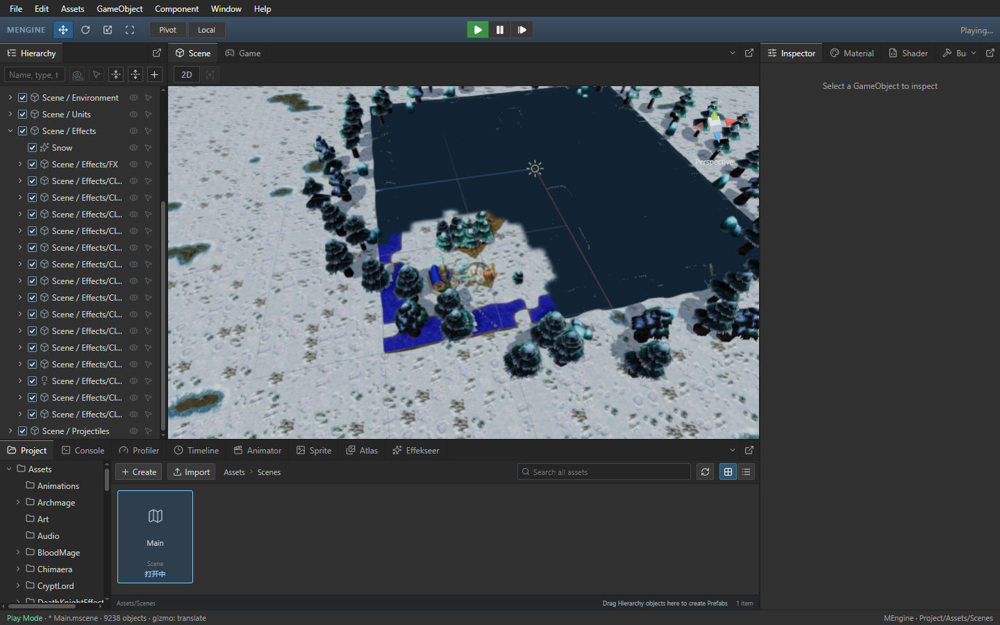

# Project 资源卡片与查询结果复用

Author: MiYu

Project 面板按现有场景、脚本、精灵、工程文件及路径索引数据复用资源卡片。目录、搜索词和资源列表变化时重新筛选；选中 ID 或资源列表变化时重新查找选中项。运行时编辑器刷新无需为全部资源重复创建卡片对象和图标。场景重命名与复制继续使用当前 sceneAssets，资源刷新和原有 import/rename/delete/metadata 流程继续驱动 libTick、sceneTick 和对应的库数组。

## Release 验收

基线 `fe0b609`，按旧版、新版、新版重复、旧版重复运行；同一 Frostbound Main.js，计时期间无构建或 CPU 测试。

| 指标 | 第一组旧版 | 第一组新版 | 第二组旧版 | 第二组新版 |
| --- | ---: | ---: | ---: | ---: |
| Scene 绘制耗时（ms） | 8.50 | 8.91 | 8.35 | 8.71 |
| Scene 新原生帧（张/秒） | 42.65 | 44.53 | 42.31 | 44.20 |
| Scene 模拟推进（次/秒） | 20.66 | 24.70 | 21.24 | 25.81 |
| Game 新原生帧（张/秒） | 38.20 | 39.39 | 39.91 | 41.26 |
| Game 模拟推进（次/秒） | 39.25 | 40.87 | 40.68 | 42.15 |
| Project 调用栈采样耗时（秒） | 0.53 | 0.01 | 0.61 | 0.01 |
| Project 自身采样耗时（秒） | 0.20 | 0.01 | 0.22 | 0.00 |
| React 调用栈采样耗时（秒） | 2.06 | 1.58 | 2.19 | 1.58 |
| GC 自身采样耗时（秒） | 0.76 | 0.57 | 0.61 | 0.62 |
| 移动空画面次数 | 0.00 | 0.00 | 0.00 | 0.00 |

两组 Project 调用栈采样耗时降低 97.6%～98.0%，Scene 模拟推进提高 19.6%～21.5%，新原生帧提高约 4.4%，Game 新原生帧提高 3.1%～3.4%。单次 Scene 绘制耗时增加约 4.2%～4.8%，本次收益来自 Project 处理及整体推进，不能据此声称 Scene 绘制算法更快。

调用栈耗时包含子调用，自身耗时仅计函数本身；各次采样约 12 秒。Project 按实际编译函数中初始 Assets/Scenes state 的代码位置识别，不依赖压缩函数名一致。父子调用耗时不可重复相加；GC 数值为采样观测，不能全部归因于本次改动。

四次移动均无空画面；模型选择、层级展开滚动、真实 Warcraft 模型姿态、粒子、UI、GPU Canvas 投影、相机预览、暂停、单步和停止重启通过，无控制台 error。两次候选的等待相机请求点击和显隐像素检查通过，像素 oracle 容差为 0.5%。

两次候选在计时结束后使用真实 Project 搜索、刷新和选中交互，新增临时材质及唯一 GUID 的 meta 后显示一张正确卡片，点击可选中；移除自有文件后刷新，搜索结果变为零，再清除搜索恢复原 Scenes 目录。证明资源库变化继续更新列表，临时文件已移除。13 项资源路径、库更新、工程启动和最近工程回归通过，前端与 Release 构建通过。[完整记录](project-asset-list-performance.json)包含进程、EXE 哈希、截图和原始报告。

四次 QA 进程已退出，隔离 Main.js 恢复且哈希一致。稳定 60 FPS、多窗口/DPR 与跨机器验收仍未完成，完整 Warcraft III 单机、联机和地图编辑器仍有后续工作。

Release 内嵌前端资源，需先执行 `npm.cmd --prefix packages/editor run build`，再执行 `cargo build --release -p mengine-editor-tauri --features custom-protocol`。
