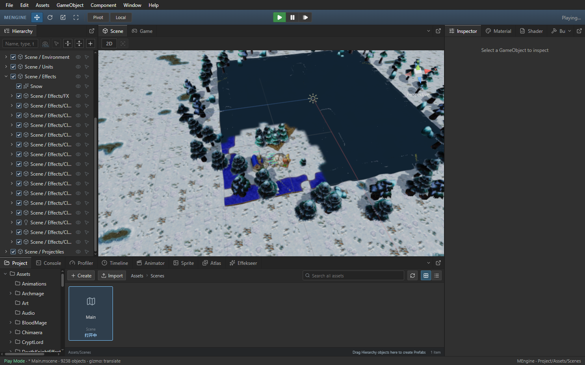

# Scene UI 与特效的节点筛选

Author: MiYu

Scene UI 布局按已显示画面的 owned entity array 复用现有 sceneUiEntities 筛选结果。保留 Canvas、Camera2D、Camera3D、它们的全部子节点和祖先；其余模型无需参与 UI 索引、布局和 UI 变换求解。新的 owned world、Canvas 增删、父子关系及相机更新会重新筛选。选择状态、视口、文本测量和投影仍在各次布局中使用当前值。

灯光、粒子和拖尾仅在 owned presentation 中先检查组件，再查询层级活动状态和变换。可变 fallback 的访问顺序保留，现有特效模拟、裁剪和绘制算法保持完整。

## Release 验收

基线为 `dfe3c6c`。同一 Frostbound Main.js，按旧版、新版、新版重复、旧版重复运行；计时采样期间没有构建或 CPU 测试。原工程 9,019 个节点中，UI 子树及依赖合计 1,530 个；运行态显隐过滤后，UI 数量随对应 owned world 变化。

| 指标 | 第一组旧版 | 第一组新版 | 第二组旧版 | 第二组新版 |
| --- | ---: | ---: | ---: | ---: |
| Scene 绘制耗时（ms） | 9.32 | 8.29 | 9.05 | 8.38 |
| Scene 新原生帧（张/秒） | 40.25 | 42.66 | 38.87 | 42.27 |
| Scene 模拟推进（次/秒） | 19.96 | 21.62 | 18.37 | 22.33 |
| Game 新原生帧（张/秒） | 39.87 | 38.58 | 40.10 | 38.96 |
| Game 模拟推进（次/秒） | 40.85 | 39.71 | 41.02 | 39.85 |
| UI 索引调用栈采样耗时（秒） | 0.32 | 0.07 | 0.31 | 0.08 |
| 活动状态查询自身采样耗时（秒） | 0.81 | 0.34 | 0.81 | 0.37 |
| render snapshot 调用栈采样耗时（秒） | 0.35 | 0.41 | 0.42 | 0.39 |
| 移动时空画面次数 | 0.00 | 0.00 | 0.00 | 0.00 |

调用栈耗时包含子调用；活动状态查询一行仅统计自身 CPU 时间。数值来自每次 12 秒移动采样，按实际编译代码位置识别，不依赖压缩函数名一致。零值表示该采样中未观察到耗时，不代表该函数从未执行。它们不可与父调用重复相加，不代表物理显示器 FPS。

四次编辑态与运行态移动均无空画面；编辑态 UI 绘制及运行态粒子保持存在。模型选择、层级展开滚动、真实 Warcraft 模型姿态、GPU Canvas 投影、相机预览、暂停、单步、停止及重启通过，无控制台 error。两次候选的暂缓相机请求点击探针和隐藏父级像素检查通过；像素 oracle 容差为 0.5%。

54 项画面、布局、世界数据回归及 14 项灯光、粒子与拖尾回归通过。新增两万无关模型节点测试比较完整世界与筛选子集的 Scene/World Space Canvas 布局和投影，覆盖无 RectTransform 子节点、祖先活动状态、指定 Camera3D 及 Camera2D、Canvas 移除/加入、节点改挂与新旧帧切换。同一 owned entity array 的多个 camera frame 复用同一筛选结果。

独立只读审核已核查 UI 依赖及 owned 来源，无阻断；主代理完成实现、测试、构建及实测。四次 QA 进程均退出，隔离 Main.js 已恢复并核对哈希。[验收记录](scene-component-layout-performance.json)保留测量、CPU 采样、进程、EXE 哈希和日志。

实际资源重载、DPR/多窗口交互的完整组合、稳定 60 FPS 和其他机器仍需进一步验收；完整 Warcraft III 单机、联机及地图编辑器仍有未完成项。



## 构建

```powershell
npm.cmd --prefix packages/editor run build
cargo build --release -p mengine-editor-tauri --features custom-protocol
```

Release EXE 内嵌前端资源，需要完成两步构建。
