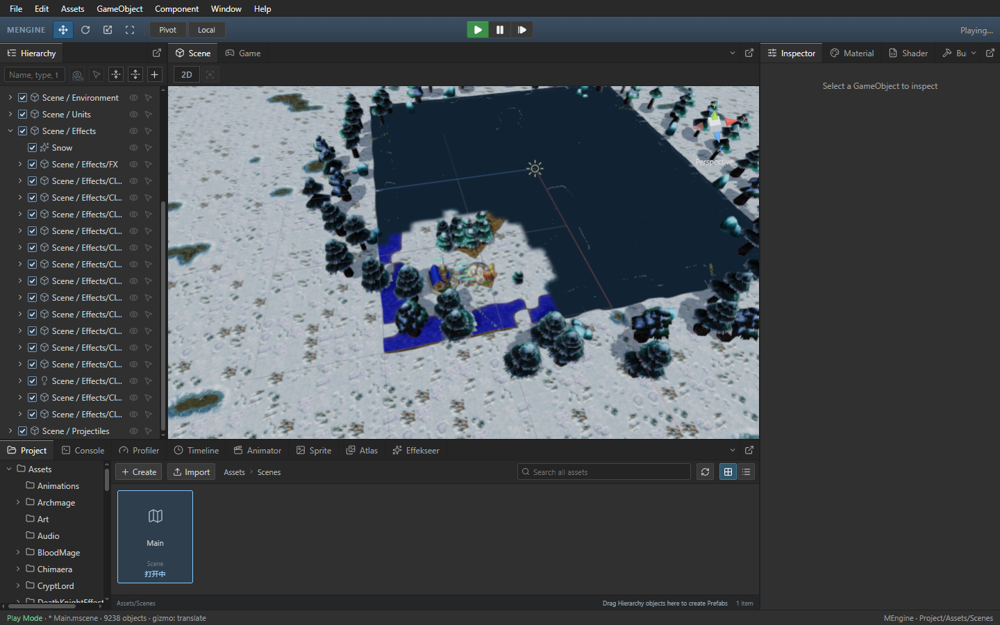

# 原生 Scene 模型点击区域复用

Author: MiYu

浏览器按已显示的原生 Scene 帧、视口位置及尺寸、实体 ID 和模型预览对象复用精确点击区域。同一画面重复重绘时，无需再次变换和投影模型顶点。新画面、视口变化、模型加载及资源刷新均会重新计算，裁剪后无区域的结果也可在同一画面内复用。缓存只保留当前一张画面的区域。

点击区域继续由 drawTriangleMesh 或 drawSolidCube 的 hitOnly 算法生成，未替换为包围盒或不同拾取几何。该算法的返回区域不受选中状态影响。相机和实体变换来自已显示画面的同一 owned world；缓存不进入 2D、Game 或原生失败后的浏览器绘制路径。显隐、活动状态、空间裁剪和 hit 列表仍按各次绘制建立。

## Release 验收

基线为 `9efa132`。同一 Frostbound Main.js，按旧版、新版、新版重复、旧版重复运行；采样时不运行构建或 CPU 测试。暂缓新相机请求并执行实际点击、暂停后的显隐像素校验均在计时采样之外。

| 指标 | 第一组旧版 | 第一组新版 | 第二组旧版 | 第二组新版 |
| --- | ---: | ---: | ---: | ---: |
| Scene 绘制耗时（ms） | 9.67 | 9.20 | 9.67 | 9.18 |
| Scene 新原生帧（张/秒） | 37.69 | 40.81 | 40.07 | 40.75 |
| Scene 模拟推进（次/秒） | 15.42 | 18.42 | 16.61 | 18.18 |
| Game 新原生帧（张/秒） | 39.75 | 38.84 | 37.93 | 38.72 |
| Game 模拟推进（次/秒） | 40.46 | 39.63 | 38.78 | 39.37 |
| mesh projection 调用栈采样耗时（秒） | 0.89 | 0.68 | 0.85 | 0.68 |
| render snapshot 调用栈采样耗时（秒） | 0.43 | 0.47 | 0.51 | 0.44 |
| 移动时空画面次数 | 0.00 | 0.00 | 0.00 | 0.00 |

调用栈耗时包含子调用，为各次 12 秒移动采样中的 CPU 总时间；通过实际 math3d 代码位置识别 drawTriangleMesh 栈，不依赖两份构建的压缩函数名相同。该值不代表物理显示器 FPS，也不可与父调用再次相加。

四次编辑态和运行态移动均无空画面；实际活动树木、城镇大厅与农民、GPU 像素、模型选择、层级展开滚动、相机预览、暂停、单步和停止重启通过，无控制台 error。两次候选暂缓新相机请求后平移视角，点击旧画面的模型选择探针仍选中原对象；随后释放请求并恢复视角。两次候选的隐藏父级、显式后代、浏览器过滤快照、恢复与再次隐藏像素检查通过，容差为 0.5%。

52 项相关前端回归通过，新增覆盖透视/正交及镜像缩放、相机帧变化、视口变化、实体代数、模型异步加载/替换/失效、裁剪空区域和 mutable fallback。新增测试加强实体代数区别后，4 项点击区域回归再次通过。独立只读审核已核查 camera、owned transforms、preview 对象的生产来源和刷新边界，无阻断；性能证据来自主代理实测。四次 QA 进程均退出，隔离 Main.js 恢复且哈希一致。[验收记录](scene-mesh-hit-reuse-performance.json)包含 CPU 采样、暂缓请求的点击证据、像素结果、EXE 哈希和日志。

实际资源重载、DPR 和多窗口交互的完整组合、稳定 60 FPS 与其他机器仍需进一步验收。完整 Warcraft III 单机、联机、地图编辑器和地图复刻仍有未完成项。



## 构建

```powershell
npm.cmd --prefix packages/editor run build
cargo build --release -p mengine-editor-tauri --features custom-protocol
```

Release EXE 内嵌前端资源，两步都需要执行。
