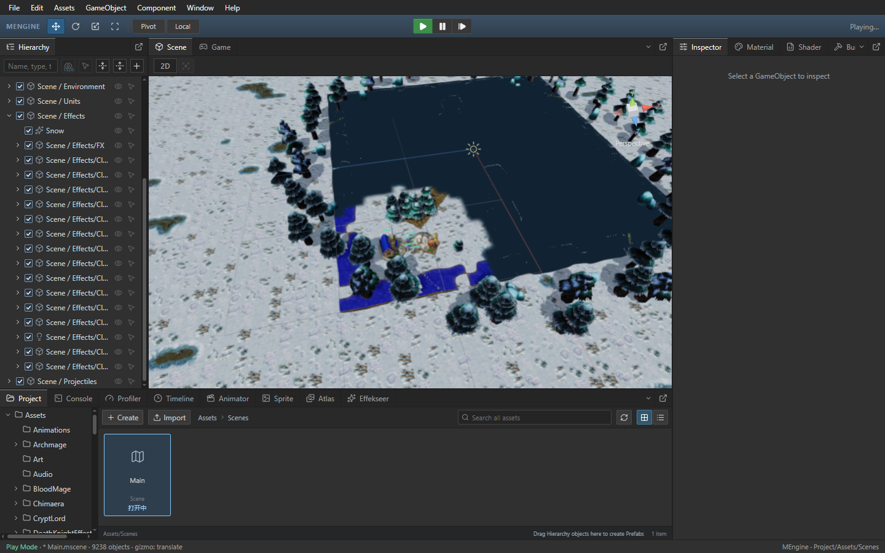

# Scene 运行帧数据复用

Author: MiYu

隐藏 Scene 分组时，浏览器从已验证的不可变原生运行记录中筛选显示数据，避免每次绘制把全部节点做一次 JSON 深拷贝。浏览器显示记录仅用于绘制和命中；原生请求仍使用过滤后的完整快照，不能凭浏览器引用复用原生 session/revision。深层 UI、Transform、父级或颜色被编辑后，运行记录校验失效，会恢复独立深拷贝。Game 的原生修订请求保持原有行为。

每张已完成的显示帧按需计算一次世界变换，后续绘制及选择使用同一帧数据。新的完成帧重算；编辑态未完成帧的实时变化仍走原有路径。缓存只保留当前一张完成帧的派生数据，包含父级旋转、镜像缩放、显隐和 Spine 所需的完整层级。

## Release 验收

同一 Frostbound 客户端，按旧 EXE、新 EXE、新 EXE 重复、旧 EXE 重复运行。每次 Game 和运行态 Scene 分别采样 12 秒，采样期间不进行构建或 CPU 测试。结束后恢复隔离工程的原始 Main.js 并验证 SHA-256。

| 指标 | 第一组旧版 | 第一组新版 | 第二组旧版 | 第二组新版 |
| --- | ---: | ---: | ---: | ---: |
| 运行态 Scene 绘制耗时（ms） | 32.77 | 19.76 | 31.74 | 20.05 |
| Scene 新原生帧（张/秒） | 9.34 | 12.79 | 9.49 | 12.84 |
| Scene 模拟推进（次/秒） | 4.18 | 6.07 | 4.50 | 5.92 |
| Game 模拟推进（次/秒） | 40.47 | 40.82 | 39.86 | 40.17 |
| 移动时空画面 | 0.00 | 0.00 | 0.00 | 0.00 |

第 1 组绘制耗时降低 39.7%，新原生帧频率提高 37.0%；第 2 组绘制耗时降低 36.8%，新原生帧频率提高 35.2%。以上是实际 WebView 画布与模拟推进数据，不代表物理显示器 FPS；稳定 60 FPS 及其他机器上的流畅性仍待验证。

四次编辑态和运行态移动均无空画面。实际原始 Warcraft 树木、城镇大厅与农民模型激活，移动中保持显示；选中策略相机后，其原生预览实际绘制。GPU 像素、模型选择、层级展开滚动、暂停、单步和停止重启验收通过，无控制台 error，所有拥有的 QA 编辑器退出。独立只读审核无阻断。

42 项前端回归全部通过，覆盖真实 store/native IPC 发布、冻结记录复用、隐藏根与子级、显隐切换、深层编辑回退及隔离、停止重启后旧 session 帧丢弃、父级旋转与负缩放、同帧变换复用和跨帧失效。测试记录和 EXE/脚本哈希及原始报告路径见 [验收记录](scene-owned-frame-performance.json)。



## 构建

```powershell
npm.cmd --prefix packages/editor run build
cargo build --release -p mengine-editor-tauri --features custom-protocol
```

编辑器 EXE 内嵌前端资源，两步均需执行。继续优化运行态 Scene 的模拟和渲染请求开销；完整 Warcraft III 单机、联机及地图编辑器复刻仍在推进。
