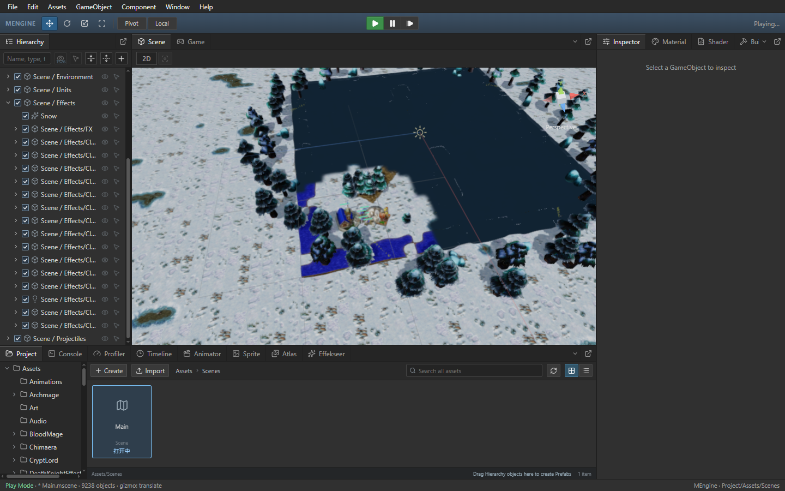

# Scene 只读查询与层级显示

Author: MiYu

激活、Scene 显隐和拾取查询只返回布尔值，不再把私有运行记录标记为外部可修改。运行态层级使用面板显示快照构造行，保留原生工厂冻结记录的引用；普通运行快照只整理元数据，组件来自独立的面板快照。编辑态层级继续使用作者数据，Timeline 激活预览不会改变层级作者复选框的含义。

外部通过 Transform、可变层级、组件或运行快照取得的引用仍被追踪。深层编辑、父级变化、外部组件别名和颜色变化仍会使原生修订引用失效，并在下一步上传。层级展开、排序、选择和按 ID 执行的编辑操作沿用原有行为。

## Release 验收

旧版为 `fb9c5b8` 的 Scene 帧复用版本。同一 Frostbound Main.js，按旧版、新版、新版重复、旧版重复运行；Game 与运行态 Scene 各采样 12 秒，期间不构建或运行 CPU 测试。四次 QA 所属进程均退出，原始隔离 Main.js 已恢复并核对哈希。

| 指标 | 第一组旧版 | 第一组新版 | 第二组旧版 | 第二组新版 |
| --- | ---: | ---: | ---: | ---: |
| Scene 绘制耗时（ms） | 21.40 | 12.38 | 19.43 | 12.24 |
| 新原生帧（张/秒） | 11.50 | 22.59 | 13.23 | 22.35 |
| Scene 模拟推进（次/秒） | 5.58 | 12.04 | 6.08 | 11.22 |
| Game 模拟推进（次/秒） | 39.75 | 40.19 | 40.04 | 39.71 |
| render snapshot 累计采样耗时（秒） | 3.93 | 0.38 | 3.65 | 0.44 |
| 移动时空画面次数 | 0.00 | 0.00 | 0.00 | 0.00 |

CPU 表格是实际采样中 `playRenderSnapshot` 调用栈的累计时间，包含子调用；不能与父调用耗时相加，也不代表 FPS。新原生帧来自 WebView 画布实际显示计数。稳定 60 FPS 和其他机器验收仍未完成。

四次编辑态和运行态移动均无空画面。真实树木、城镇大厅和农民的活动动画模型、实际 GPU 像素、模型点击选择、层级展开与滚动、选中相机的原生预览、暂停、单步及停止重启验收通过，无控制台 error。

37 项回归通过，包含 Timeline 正反激活预览下的作者状态与切换、显示旧帧和新帧、深组件与父级编辑上传、可变入口的引用检测、原生生命周期、层级和显隐查询。独立只读审核无阻断。[完整验收记录](scene-readonly-query-performance.json)包含哈希、日志和原始报告路径。



## 构建

```powershell
npm.cmd --prefix packages/editor run build
cargo build --release -p mengine-editor-tauri --features custom-protocol
```

Release EXE 内嵌前端资源，两步都需要执行。完整 Warcraft III 单机、联机、地图编辑器及地图复刻仍有未完成项；本记录仅验收当前性能改动。
