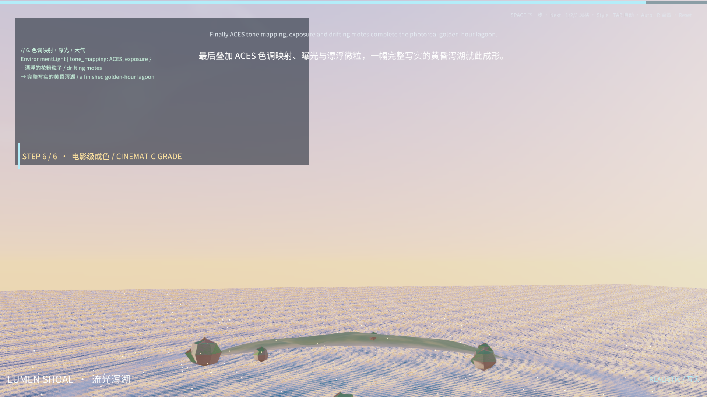

# Lumen Shoal / 流光泻湖

一个原创的 3D 展示型 sample：以「分步教学」的方式，从空场景一路搭建到一幅写实的黄昏泻湖，
逐步演示 **3D 场景、法线、水体渲染、反射、体积云** 等效果，并可一键切换 **写实 / 低多边形 / 像素**
三种风格。整个演示由脚本驱动，画面左下角用代码块 + 中英双语字幕讲解当前进度，像一条视频旁白。

> 说明：QoderWork 无法直接产出视频文件，本 sample 把「视频脚本」搬进了引擎——打开即自动播放这条
> 分步演示，可用键盘交互，也可作为录制视频的底稿。



## 运行

在 MEngine 编辑器里打开本目录的 `project.json`，进入 Game / Play 即可自动播放整条演示。
或从仓库根目录用命令行：

```bash
npm run build:samples          # 编译 Main.ts -> Main.js
cargo run -p mengine-runtime -- --sample lumen-shoal
```

## 操作 / Controls

| 键 | 作用 |
| --- | --- |
| （自动） | 每 7.5 秒推进一步，共 6 步 |
| `SPACE` | 下一步 / Next step |
| `TAB` | 开/关自动播放 / Toggle auto-play |
| `1` `2` `3` | 切换风格：写实 / 低多边形 / 像素 |
| `R` | 重置到第一步 |

## 分步演示 / The six steps

1. **建立 3D 场景** — 摄像机 + 方向光 + 环境光，几何体全部由 `scripts/create-lumen-shoal.py` 程序化生成（GLB）。
2. **法线细节** — 岛屿/岩石用切线空间法线贴图（`island-normal.png`），TBN 由屏幕导数实时构造，无需切线属性。
3. **水体动画** — 海面是多重正弦高度场，逐像素求导得到动态法线，并叠加近岸浪花；网格顶点保持静止。
4. **镜面反射** — 压低水面粗糙度，引擎的图像基光照（IBL）把天空、云与落日倒映成镜。
5. **体积云** — 用域扭曲 fbm 生成蓬松积云密度并做朝日散射，烘焙进等距柱状环境贴图；切图后天空与水面反射同步更新。
6. **电影级成色** — ACES 色调映射 + 曝光 + 漂浮花粉微粒，得到完整的写实黄昏泻湖。

## 风格化 / Stylised modes

`1/2/3` 在同一个着色器里通过 `style` 参数切换：

- **写实**：平滑法线 + 完整 PBR 反射 + 体积云。
- **低多边形**：用 `cross(dFdx,dFdy)` 求面法线做平面着色，量化波纹与调色板。
- **像素**：把波场/密度对齐到粗网格并做有限色阶量化，得到像素画质感。

## 实现要点

- 着色器是引擎的 Surface Shader（`.mshader`，WGSL + `MENGINE_PARAMETERS` 头），通过
  `mengine_lit_surface_hook` 改写法线/颜色/粗糙度，反射与光照交给引擎固定管线。
- 材质 `.mmat`（version 10）绑定自定义着色器、法线贴图与 `clock/reveal/style` 参数。
- `Main.ts` 每帧用 `MaterialPropertyBlock` 推送参数、用 `EnvironmentLight` 切换天空贴图、
  驱动运镜与 UI 文本；UI 用 Canvas + RectTransform（`anchored_position` 以屏幕中心为原点）+ Text。
- 中文用 `Assets/Fonts/NotoSansSC.ttf`（与 frostbound-realms 同源）渲染。

## 复现与验收

```powershell
python scripts/create-lumen-shoal.py        # 重建网格、贴图、场景
npm run build:samples                        # 编译脚本
node scripts/qa-lumen-shoal.mjs              # 原生编辑器实机：6 步 + 3 风格截图，断言 0 条被拒管线
```

`scripts/qa-lumen-shoal.mjs` 需要预编译的编辑器可执行文件（默认 `target/release/mengine-editor-tauri.exe`，
可用 `MENGINE_EDITOR_EXECUTABLE` 覆盖）。截图输出到 `docs/designs/lumen-shoal/`。
最近一次实机验收：`native-lumen-qa.json` 记录 `materialPipelinesRejected = 0`，六个阶段与三种风格均成功渲染。

## 资源来源

模型、着色器、材质、脚本、程序化贴图与合成数据均为本示例原创，遵循仓库 MIT 许可证。
`NotoSansSC.ttf` 复用自 `samples/frostbound-realms`（SIL OFL）。本示例不依赖任何第三方商业美术资产。
